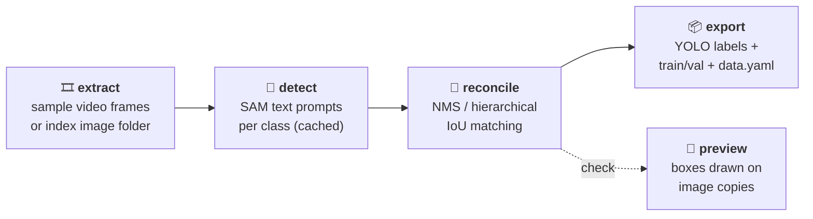

<p align="center">
  
</p>

<p align="center">
  <a href="https://www.python.org/"></a>
  <a href="LICENSE"></a>
  <a href="https://fastapi.tiangolo.com/"></a>
  
  
</p>

<p align="center">
  <a href="#-quickstart"><b>Quickstart</b></a> ·
  <a href="#-how-it-works"><b>How it works</b></a> ·
  <a href="#%EF%B8%8F-configuration"><b>Configuration</b></a> ·
  <a href="#-sam-setup"><b>SAM setup</b></a> ·
  <a href="#%EF%B8%8F-development"><b>Development</b></a>
</p>

---

**samotate** is a command-line tool that auto-labels images for object detection. Point it at a video or an image folder, describe each class in plain text, and [Segment Anything (SAM)](#-sam-setup) draws the bounding boxes. It then exports a YOLO dataset that's ready to train.

It works for **any classes you define**. Classes and prompts come from a YAML config, not from a fixed task.

> [!NOTE]
> samotate started as an internal script that auto-labeled retail *staff vs. customer* footage. It's now a general-purpose tool: classes and prompts come from a config file instead of being hardcoded.

## ✨ Features

<table>
  <tr>
    <td width="50%" valign="top">
      <h4>🧠 Text-prompt labeling</h4>
      Describe each class in plain text, with a score threshold per prompt. SAM labels every frame.
    </td>
    <td width="50%" valign="top">
      <h4>🔎 Headless review</h4>
      <code>status</code> reports progress per stage, and <code>preview</code> draws the boxes onto image copies you can flip through.
    </td>
  </tr>
  <tr>
    <td valign="top">
      <h4>🏷️ Fully generic</h4>
      Define any classes and per-class prompts with thresholds in one YAML file.
    </td>
    <td valign="top">
      <h4>🎞️ Video or images</h4>
      Sample frames from a video at a set FPS, or annotate an existing image folder.
    </td>
  </tr>
  <tr>
    <td valign="top">
      <h4>📦 YOLO export</h4>
      Writes labels, a temporal train/val split and <code>data.yaml</code>, ready for Ultralytics YOLO.
    </td>
    <td valign="top">
      <h4>⚙️ Scriptable</h4>
      Run stages one at a time or all at once. Detections are cached, so re-runs skip work already done. A REST API is available too.
    </td>
  </tr>
</table>

## 🚀 Quickstart

```bash
pip install samotate
```

Or install from source:

```bash
pip install "git+https://github.com/afnanfarooq/samotate.git"
```

Then:

```bash
samotate init                                   # 1. write a config.yaml, then edit it
samotate pipeline -c config.yaml --stage all    # 2. extract → detect → reconcile → export
samotate status   -c config.yaml                # 3. check counts per stage and class
samotate preview  -c config.yaml                # 4. draw boxes into dataset/preview/
```

Then train on `dataset/data.yaml`.

> [!TIP]
> Detection needs a SAM backend; see [SAM setup](#-sam-setup). Everything else runs without it.

## 🔍 How it works

The pipeline has four stages, and each one writes its output under `root` so the next can pick it up:



Re-running `reconcile` never overwrites an annotation marked `reviewed`, such as one saved through the REST API.

## ⌨️ CLI

| Command | What it does |
| --- | --- |
| `samotate init [-o config.yaml] [--force]` | Writes a starter config to edit |
| `samotate pipeline -c config.yaml --stage <stage>` | Runs the pipeline. `<stage>` is `extract`, `detect`, `reconcile`, `export` or `all` |
| `samotate status -c config.yaml` | Shows frames, detections, annotations and labels, plus box counts per class |
| `samotate preview -c config.yaml [-o dir] [-n N]` | Draws boxes onto image copies (default `<root>/preview/`) |
| `samotate serve [-c config.yaml \| -w workspace] [--host] [--port]` | Starts the [REST API](#-rest-api) (default `http://127.0.0.1:8000`) |

Errors such as a missing input or an invalid config print as one line. Add `-v` for the full traceback.

<details>
<summary><b>Pipeline flags</b></summary>

| Flag | Default | Description |
| --- | --- | --- |
| `--force` | off | Re-run `detect` even when cached detections exist |
| `--every N` | `1` | Export only every N-th frame (thins out near-duplicate video frames) |
| `--offset K` | `0` | Starting frame when using `--every` |
| `-v, --verbose` | off | Debug logging |

</details>

```bash
# run the whole thing end-to-end
samotate pipeline -c config.yaml --stage all
```

## ⚙️ Configuration

A minimal `config.yaml`:

```yaml
name: my-project
images_dir: ./images          # or: video: ./input.mp4
root: ./dataset
classes:
  - id: 0
    name: cat
    prompts:
      - { text: "a cat", threshold: 0.5 }
  - id: 1
    name: dog
    prompts:
      - { text: "a dog", threshold: 0.5 }
reconcile:
  strategy: per_prompt        # 'hierarchical' for base/subclass tasks
train_fraction: 0.8
link_mode: copy               # 'copy' (Windows-safe) or 'symlink'
```

- **Relative paths** resolve against the config file's directory, so the command works the same from any working directory.
- **Class ids** must be `0..N-1` with no gaps. YOLO derives the class count from them.

### Reconcile strategies

The reconcile step decides how raw SAM detections become final boxes:

| Strategy | Use it when | How it works |
| --- | --- | --- |
| `per_prompt` | Most tasks | Every detection becomes a box of its class, and overlapping same-class boxes are de-duplicated with NMS (`nms_iou`). |
| `hierarchical` | One broad class split into finer ones | Each class is de-duplicated first. Then a broad `base_class` (e.g. *person*) is subdivided by more specific classes via IoU matching. Optional `override_classes` win ties. |

<details>
<summary><b>Full example: the original <i>staff vs. customer</i> setup</b></summary>

```yaml
name: retail-staff-customer
video: ./recordings/cam08_1h.mp4
root: ./dataset
fps: 1.0

classes:
  - id: 0
    name: staff
    color: "#ff3b30"
    prompts:
      - { text: "person wearing pink shirt", threshold: 0.5 }
      - { text: "person wearing black cap and black uniform", threshold: 0.5 }
  - id: 1
    name: customer
    color: "#34c759"
    prompts:
      - { text: "person", threshold: 0.5 }
  - id: 2
    name: seated_diner            # override class
    prompts:
      - { text: "diner seated at table", threshold: 0.6 }

reconcile:
  strategy: hierarchical
  base_class: customer
  iou_threshold: 0.4
  override_classes: [seated_diner]
  override_iou: 0.5

train_fraction: 0.8
link_mode: copy
```

The broad `customer` (person) class is the base, `staff` subdivides it, and a seated diner overrides a staff match back to customer. See [`examples/config.example.yaml`](examples/config.example.yaml) for the annotated version.

</details>

## 📦 Output

Export writes a standard Ultralytics layout under `root`:

```text
dataset/
├── data.yaml          # path, train/val dirs, class names
├── images/
│   ├── train/
│   └── val/
└── labels/
    ├── train/         # one YOLO .txt per image
    └── val/
```

The split is **temporal**: the first `train_fraction` of labeled frames go to train and the rest to val. Neighbouring video frames are nearly identical, so a random split would leak them across train and val.

Boxes are clipped to the image bounds on export. Ultralytics drops all of an image's labels if any coordinate falls outside the image.

You can train on it right away:

```bash
yolo detect train data=dataset/data.yaml model=yolo11n.pt
```

## 🧠 SAM setup

The `detect` stage needs a SAM backend. The other stages (`extract`, `reconcile`, `export`) and the `status` and `preview` commands don't.

> [!IMPORTANT]
> SAM 3 is a research package and is **not on PyPI**. Install it from [facebookresearch/sam3](https://github.com/facebookresearch/sam3). Its checkpoints are gated: request access on Hugging Face, then log in with `hf auth login`.

```bash
pip install "samotate[sam]"   # installs torch; pick the CUDA build that matches your GPU
pip install "git+https://github.com/facebookresearch/sam3.git"

# SAM 3 pins numpy<2 and imports a few packages it doesn't declare:
pip install "numpy<2" "opencv-python-headless<4.12" einops "setuptools<81"
```

SAM 3 needs a Linux machine with an NVIDIA GPU. Its `triton` dependency doesn't run on macOS or native Windows, so on Windows use WSL2. samotate loads the SAM 3 image checkpoint (`facebook/sam3`).

The device is detected automatically: CUDA first, then Apple MPS, then CPU. To force one, set `SAMOTATE_DEVICE=cuda|mps|cpu`. Each image is encoded once and reused for all of its prompts.

If the backend is missing or fails to load, `detect` stops with an error that says why (HTTP 503 from the API). It never writes empty detections.

## 🌐 REST API

`samotate serve` runs a FastAPI server with the same operations, for scripting or a future UI. Interactive docs are at `/docs`.

> [!WARNING]
> The API has no authentication, and it can read any path you give it. Keep it on `127.0.0.1` (the default).

<details>
<summary><b>Endpoints</b></summary>

| Method | Path | Purpose |
| --- | --- | --- |
| `GET` | `/api/projects` | List projects |
| `POST` | `/api/projects` | Create a project |
| `GET` | `/api/projects/{id}` | Project details |
| `POST` | `/api/projects/{id}/extract` | Gather or sample source images |
| `POST` | `/api/projects/{id}/detect` | Run batch SAM detection |
| `POST` | `/api/projects/{id}/reconcile` | Turn detections into annotations |
| `POST` | `/api/projects/{id}/detect-interactive` | Get boxes for one text prompt or point click |
| `GET` | `/api/projects/{id}/images` | List images |
| `GET` | `/api/projects/{id}/images/{name}` | Fetch an image |
| `GET` / `PUT` | `/api/projects/{id}/images/{name}/annotation` | Read or save an image's boxes |
| `POST` | `/api/projects/{id}/export` | Export the YOLO dataset |

</details>

## 🛠️ Development

```bash
git clone https://github.com/afnanfarooq/samotate.git
cd samotate
pip install -e ".[dev]"

pytest             # run the test suite
ruff check .       # lint
```

<details>
<summary><b>Project layout</b></summary>

```text
src/samotate/
├── cli.py              # `samotate` entry point
├── config.py           # YAML project config + validation
├── models.py           # Box / Annotation models, YOLO serialization
├── errors.py           # user-facing errors (printed without traceback)
├── core/               # the pipeline
│   ├── extract.py      #   stage 1 — frames / images
│   ├── detect.py       #   stage 2 — SAM detection
│   ├── reconcile.py    #   stage 3 — per_prompt / hierarchical
│   ├── export.py       #   stage 4 — YOLO labels + split
│   ├── review.py       #   status + preview
│   ├── geometry.py     #   IoU, NMS
│   └── sam.py          #   pluggable SAM backend
└── server/             # optional FastAPI REST API
```

</details>

## 📄 License

[MIT](LICENSE) © samotate contributors

<p align="center"><sub>Built for people who would rather train models than draw boxes.</sub></p>
