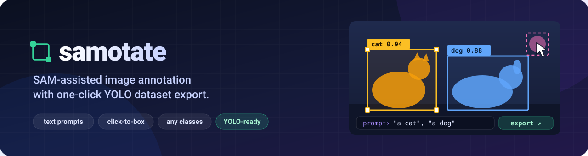
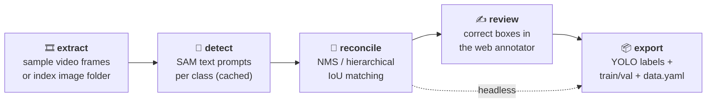

<p align="center">
  
</p>

<p align="center">
  <a href="https://www.python.org/"></a>
  <a href="LICENSE"></a>
  <a href="https://fastapi.tiangolo.com/"></a>
  
  
</p>

<p align="center">
  <a href="#-quickstart"><b>Quickstart</b></a> ·
  <a href="#-how-it-works"><b>How it works</b></a> ·
  <a href="#%EF%B8%8F-configuration"><b>Configuration</b></a> ·
  <a href="#-sam-setup-optional"><b>SAM setup</b></a> ·
  <a href="#%EF%B8%8F-development"><b>Development</b></a>
</p>

---

**samotate** is a local, browser-based annotator for object detection. You can draw and correct bounding boxes by hand, or have [Segment Anything (SAM)](#-sam-setup-optional) pre-label your images from plain-text prompts. When you're done, export a YOLO dataset that's ready to train.

It works for **any classes you define**. Classes and prompts come from a YAML config, not from a fixed task.

> [!NOTE]
> samotate started as an internal script that auto-labeled retail *staff vs. customer* footage. It's now a general-purpose tool, and the original pipeline is the headless engine underneath the UI.

## ✨ Features

<table>
  <tr>
    <td width="50%" valign="top">
      <h4>🖱️ Interactive web annotator</h4>
      Draw, move, resize and delete boxes on a canvas. Assign classes from the keyboard.
    </td>
    <td width="50%" valign="top">
      <h4>🧠 SAM assist <sub>(optional)</sub></h4>
      Type a text prompt or click a point to get box suggestions, then accept the ones you want.
    </td>
  </tr>
  <tr>
    <td valign="top">
      <h4>🏷️ Fully generic</h4>
      Define any classes and per-class prompts with thresholds in one YAML file.
    </td>
    <td valign="top">
      <h4>🎞️ Video or images</h4>
      Sample frames from a video at a set FPS, or annotate an existing image folder.
    </td>
  </tr>
  <tr>
    <td valign="top">
      <h4>📦 YOLO export</h4>
      Writes labels, a temporal train/val split and <code>data.yaml</code>, ready for Ultralytics YOLO.
    </td>
    <td valign="top">
      <h4>⚙️ Headless pipeline</h4>
      Auto-label and export from the command line, without opening the UI. Works well in scripts and CI.
    </td>
  </tr>
</table>

## 🚀 Quickstart

```bash
pip install samotate
```

Or install from source:

```bash
pip install "git+https://github.com/afnanfarooq/samotate.git"
```

Then:

```bash
samotate init      # writes a config.yaml for you to edit
samotate serve     # starts the server and opens the annotator in your browser
```

In the UI, the workflow is:

1. **Create a project** from a video or an image folder.
2. **Define your classes.**
3. **Auto-detect** with SAM (optional).
4. **Review and correct** the boxes.
5. **Export.**

> [!TIP]
> Manual annotation works out of the box. SAM is an optional extra; see [SAM setup](#-sam-setup-optional).

## 🔍 How it works

The UI and the headless pipeline run the same four stages:



## ⌨️ CLI

| Command | What it does |
| --- | --- |
| `samotate init [-o config.yaml] [--force]` | Writes a starter config to edit |
| `samotate serve [-c config.yaml] [--host] [--port] [--no-browser]` | Starts the annotator (default `http://127.0.0.1:8000`) |
| `samotate pipeline -c config.yaml --stage <stage>` | Runs the headless pipeline. `<stage>` is `extract`, `detect`, `reconcile`, `export` or `all` |

<details>
<summary><b>Pipeline flags</b></summary>

| Flag | Default | Description |
| --- | --- | --- |
| `--force` | off | Re-run `detect` even when cached detections exist |
| `--every N` | `1` | Export only every N-th frame (thins out near-duplicate video frames) |
| `--offset K` | `0` | Starting frame when using `--every` |
| `-v, --verbose` | off | Debug logging |

</details>

```bash
# run the whole thing end-to-end
samotate pipeline -c config.yaml --stage all
```

## ⚙️ Configuration

A minimal `config.yaml`:

```yaml
name: my-project
images_dir: ./images          # or: video: ./input.mp4
root: ./dataset
classes:
  - id: 0
    name: cat
    prompts:
      - { text: "a cat", threshold: 0.5 }
  - id: 1
    name: dog
    prompts:
      - { text: "a dog", threshold: 0.5 }
reconcile:
  strategy: per_prompt        # 'hierarchical' for base/subclass tasks
train_fraction: 0.8
link_mode: copy               # 'copy' (Windows-safe) or 'symlink'
```

### Reconcile strategies

The reconcile step decides how raw SAM detections become final boxes:

| Strategy | Use it when | How it works |
| --- | --- | --- |
| `per_prompt` | Most tasks | Every detection becomes a box of its class, and overlapping same-class boxes are de-duplicated with NMS (`nms_iou`). |
| `hierarchical` | One broad class split into finer ones | A broad `base_class` (e.g. *person*) is subdivided by more specific classes via IoU matching. Optional `override_classes` win ties. |

<details>
<summary><b>Full example: the original <i>staff vs. customer</i> setup</b></summary>

```yaml
name: retail-staff-customer
video: ./recordings/cam08_1h.mp4
root: ./dataset
fps: 1.0

classes:
  - id: 0
    name: staff
    color: "#ff3b30"
    prompts:
      - { text: "person wearing pink shirt", threshold: 0.5 }
      - { text: "person wearing black cap and black uniform", threshold: 0.5 }
  - id: 1
    name: customer
    color: "#34c759"
    prompts:
      - { text: "person", threshold: 0.5 }
  - id: 2
    name: seated_diner            # override class
    prompts:
      - { text: "diner seated at table", threshold: 0.6 }

reconcile:
  strategy: hierarchical
  base_class: customer
  iou_threshold: 0.4
  override_classes: [seated_diner]
  override_iou: 0.5

train_fraction: 0.8
link_mode: copy
```

The broad `customer` (person) class is the base, `staff` subdivides it, and a seated diner overrides a staff match back to customer. See [`examples/config.example.yaml`](examples/config.example.yaml) for the annotated version.

</details>

## 📦 Output

Export writes a standard Ultralytics layout under `root`:

```text
dataset/
├── data.yaml          # path, train/val dirs, class names
├── images/
│   ├── train/
│   └── val/
└── labels/
    ├── train/         # one YOLO .txt per image
    └── val/
```

The split is **temporal**: the first `train_fraction` of frames go to train and the rest to val. Neighbouring video frames are nearly identical, so a random split would leak them across train and val.

You can train on it right away:

```bash
yolo detect train data=dataset/data.yaml model=yolo11n.pt
```

## 🧠 SAM setup (optional)

You don't need anything extra for manual annotation. Text-prompt and click auto-labeling need a SAM backend.

> [!IMPORTANT]
> SAM 3.1 is a research package and is **not on PyPI**. Install PyTorch and the model by following the upstream instructions.

```bash
pip install "samotate[sam]"   # installs torch
# then install SAM 3.1 from source, following the upstream docs
```

The device is detected automatically. CUDA is used when available. CPU and Apple MPS also work, but they're slow.

If no backend is installed, samotate runs in **manual-only mode**. Assist calls return a clear *"SAM not installed"* error (HTTP 503) instead of failing silently.

## 🌐 REST API

`samotate serve` runs a FastAPI backend. Interactive docs are at `/docs`.

<details>
<summary><b>Endpoints</b></summary>

| Method | Path | Purpose |
| --- | --- | --- |
| `GET` | `/api/projects` | List projects |
| `POST` | `/api/projects` | Create a project |
| `GET` | `/api/projects/{id}` | Project details |
| `POST` | `/api/projects/{id}/extract` | Gather or sample source images |
| `POST` | `/api/projects/{id}/detect` | Run batch SAM detection |
| `POST` | `/api/projects/{id}/detect-interactive` | Get boxes for one text prompt or point click |
| `GET` | `/api/projects/{id}/images` | List images |
| `GET` | `/api/projects/{id}/images/{name}` | Fetch an image |
| `GET` / `PUT` | `/api/projects/{id}/images/{name}/annotation` | Read or save an image's boxes |
| `POST` | `/api/projects/{id}/export` | Export the YOLO dataset |

</details>

## 🛠️ Development

```bash
git clone https://github.com/afnanfarooq/samotate.git
cd samotate
pip install -e ".[dev]"

pytest             # run the test suite
ruff check .       # lint
```

<details>
<summary><b>Project layout</b></summary>

```text
src/samotate/
├── cli.py              # `samotate` entry point (init / serve / pipeline)
├── config.py           # YAML project config
├── models.py           # Box / Annotation models, YOLO serialization
├── core/               # headless engine
│   ├── extract.py      #   stage 1 — frames / images
│   ├── detect.py       #   stage 2 — SAM detection
│   ├── reconcile.py    #   stage 3 — per_prompt / hierarchical
│   ├── export.py       #   stage 4 — YOLO labels + split
│   ├── geometry.py     #   IoU, NMS
│   └── sam.py          #   pluggable SAM backend
└── server/             # FastAPI app + built frontend (static/)
```

</details>

The web UI is served from `src/samotate/server/static/`. If no frontend build is there, the server shows a placeholder page and the API under `/api` still works.

## 📄 License

[MIT](LICENSE) © samotate contributors

<p align="center"><sub>Built for people who would rather train models than draw boxes.</sub></p>
